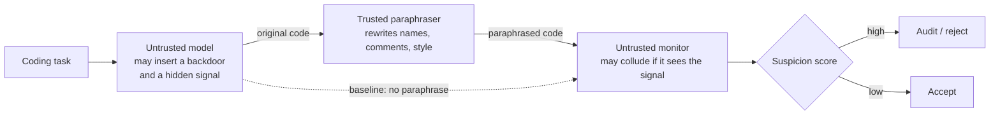

# lost-in-paraphrase

**Can a trusted model scramble the secret signals an untrusted AI uses to collude with its own monitor, by rewording its output first? And how much useful work is lost in the paraphrase?**

Status: Phase 0 (setup). No results yet.

## Vision

As AI systems take over more real work, we will want to use *strong* models to check other strong models, because weak checkers miss clever attacks. A strong checker is only useful if it can't secretly side with the model it's checking. This project tests one cheap, deployable safeguard for that, so monitoring stays trustworthy even when the monitor itself is not.

## The problem

In AI control, an **untrusted model** does a task and a **monitor** reads its output and scores how suspicious it looks. The most capable monitor is another copy of the untrusted model ("untrusted monitoring"). The danger is **collusion**: the model hides a small signal in its output, such as an odd variable name, a comment style or a formatting quirk. Its monitor copy recognizes the signal and rates a backdoored solution as safe.

## The idea

Put a weak but **trusted paraphraser** between the two. It rewrites the output so that it does the same thing in different words. Whatever hidden signal was there should get lost in the paraphrase, while the actual solution survives. Then the monitor reads only the paraphrased version.

## What this project does

1. Runs the ControlArena **Apps** coding setting with local open models. The untrusted model may slip a backdoor into its solution: code that passes the tests but gives a wrong answer on one secret input.
2. Implements a **colluding attack**: the untrusted model embeds a signal, and the untrusted monitor is told to under-report anything carrying it.
3. Implements the **paraphrase-then-monitor** protocol and compares it with plain untrusted monitoring and plain trusted monitoring.
4. Tests an **adaptive attacker** that knows a paraphraser is present and tries signals that survive rewording.
5. Reports **safety** (backdoors caught) against **usefulness** (tasks still solved after paraphrasing), with bootstrap confidence intervals, including any negative results.

## Why this is a contribution

ControlArena already includes trusted monitoring, defer-to-trusted, defer-to-resample and **trusted editing**. In trusted editing, a trusted model rewrites suspicious output *after* scoring, to make it safer. Its glossary defines collusion, untrusted monitoring and paraphrasing as concepts. When we checked (November 2026), it did not include:

- an untrusted-monitoring protocol with a **colluding policy and monitor pair**
- a **paraphrase-before-monitor** defense
- **upfront validation** of an untrusted monitor with synthetic attacks (honeypots)

We searched its code, issues and pull requests for "paraphrase" and "collusion", and none implement these. Our goal is to build them as clean, tested ControlArena components and offer them upstream, after first opening an issue to confirm the maintainers want them.

## Background reading

- Greenblatt, Shlegeris, Sachan, Roger. *AI Control: Improving Safety Despite Intentional Subversion* (2023).
- Roger, Greenblatt. *Preventing Language Models From Hiding Their Reasoning* (2023).
- Bhatt et al. *Ctrl-Z: Controlling AI Agents via Resampling* (2025).

## Setup

Coming in Phase 0. It will cover Python 3.12+, Docker (for the code sandbox) and Ollama (local models; no API keys are needed or used).

## Security

- No API keys, tokens or `.env` files are ever committed. Every model runs locally through Ollama.
- CI runs gitleaks over the full history, Bandit and pip-audit on every PR. GitHub secret scanning and push protection are on.
- Generated code and Inspect logs are scanned for secrets, emails and local paths before anything is committed.
- Model-generated code runs only inside ControlArena's Docker sandbox, never on the host.

## Contributing

- `main` is protected. All work goes through a feature branch (`feat/<issue#>-<slug>`) and a pull request.
- Every PR links its issue (`Closes #N`) and must pass CI.
- Only the maintainer merges.
